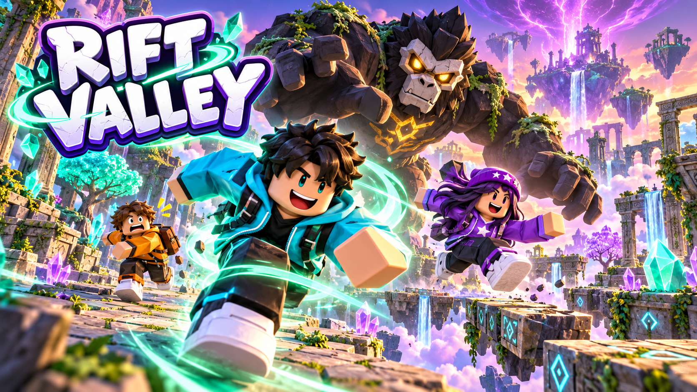

# Rift Valley

A multiplayer Roblox chase and obstacle-course game built with Luau, native Roblox geometry and procedural character animation.

[Play Rift Valley](https://www.roblox.com/games/86531279798778/Rift-Valley) · [Architecture](docs/ARCHITECTURE.md) · [Testing and limitations](docs/TESTING.md)



## The game

**Run to Finish!** Sprint, jump and wind-dash through five connected courses while creatures try to intercept you. Dodge a warned grab, manage stamina, collect glowing buffs and reach the final gate. Getting caught turns a runner into a catcher.

Players vote for Crystal Grove, Sunset Ruins or Neon Harbor. Each theme changes the scenery and course mechanics, including boost bridges, crumbling stones and moving cargo. Between rounds, players can explore the lobby, attempt 24-jump parkour, practice reached courses and unlock cosmetics.

- Server-controlled matches, map voting, course transitions and rewards.
- Catcher pathfinding, distinct pursuit archetypes, attack warnings and capture animation.
- Sprint and dash authorization, stamina management and wind effects.
- Coin cosmetics, daily goals, course mastery and a personal-best parkour ghost.
- Session-leased player profiles with guarded saves and failure handling.
- Roblox-verified game passes, current-price lookup and explicit purchase prompts.
- A separate VIP activity arena with coils and a blaster. Paid gear stays inside that arena.

The experience has a configured **30-player capacity**. Current native multiplayer evidence covers **three clients**, not a 30-player load test. The last verified public release had **16+ access**.

## Technical work

The project separates server authority, client presentation and shared rules across 32 production Luau scripts. The server validates movement abilities, pickups, finishes, purchases and combat. Client effects handle animation, music, sky ambience and interface presentation.

Python builders generate the world and visual assets. Lune tests exercise actual Luau modules, validate the place and build the native binary. Separate Studio harnesses test real engine physics and multiple native clients without publishing fixtures or writing live profiles.

Created by Tyler Greaves with AI-assisted implementation and asset generation. This repository presents the implementation and measured checks; it does not claim human playtest or production-scale performance sign-off.

## Open in Roblox Studio

1. Download or clone this repository.
2. Open [`dist/RiftValley.rbxl`](dist/RiftValley.rbxl) in Roblox Studio.
3. Start a local Test session. Use Server & Clients for multiplayer checks.

The supplied binary contains the world, scripts and interface. Studio uses session-only profiles and disables real purchases. Stop and reopen a place after rebuilding it; an already-open Studio tab keeps its in-memory copy.

## Build and check

The recorded local toolchain uses Python 3.12, Lune 0.11.0 and Luau 0.742. Install [Lune](https://lune-org.github.io/docs) and the [Luau CLI tools](https://github.com/luau-lang/luau), then install the Python dependencies:

```powershell
python -m pip install -r requirements.txt
```

Validate the included XML and regenerate the binary:

```powershell
lune run tests/place.spec.luau
```

Run the rules and audio checks:

```powershell
luau tests/rules.spec.luau
python tests/audio.spec.py
```

Run the other Luau test suites with Lune from the repository root:

```powershell
Get-ChildItem tests/*.spec.luau |
    Where-Object Name -ne 'rules.spec.luau' |
    ForEach-Object {
        lune run $_.FullName
        if ($LASTEXITCODE -ne 0) { throw "Failed: $($_.Name)" }
    }
```

Compile production scripts with `luau-compile --null`. To intentionally regenerate the world XML and geometric artwork, run `python build/build_place.py`, then validate the place again. Some artwork helpers use Windows fonts. The included Studio binary works without the Python toolchain.

## Verification

Recorded Studio runs against the configured 0.15.0 sources demonstrated:

| Check | Recorded result |
| --- | --- |
| Exported public files | 38 Luau suites, audio suite and 32 script compilations passed |
| Three native clients | Full five-course escapes on all three maps |
| Crystal Grove / Sunset Ruins / Neon Harbor | 2 / 1 / 1 escapes |
| Catcher route physics | 24 of 24 passed |
| Individual parkour transfers | 24 of 24 passed |
| Catcher startup | All 74 observed catchers moved within one second |
| Music | All four configured tracks loaded and entered playback |

These runs used automated input. Live saves, genuine paid purchases, live analytics delivery, physical-device testing and 30-player performance remain unverified. Studio also logged a Roblox CoreScripts chat initialization error that needs a live check. See [the testing record](docs/TESTING.md) for scope and limitations.

## Project layout

| Directory | Contents |
| --- | --- |
| `src/server` | Match loop, navigation, profiles, progression, passes and combat |
| `src/client` | HUD, input, creature poses, wind, music and visual effects |
| `src/shared` | Configuration, pure rules, animation data and public asset IDs |
| `tests` | Module tests and isolated Studio harnesses |
| `build` | World generation, artwork helpers and test-copy builders |
| `assets` | Original artwork, geometric previews and composed audio loops |
| `dist` | Current Studio place and catcher model assets |
| `deploy` | Public configuration and deployment instructions |

The artwork includes generated illustrations and rendered native-geometry previews. Illustrations are promotional artwork, not gameplay screenshots. Music playback references Roblox Creator Store assets; this repository includes only the project's separate original WAV compositions. See [asset notes](docs/ASSETS.md).

The game-pass and audio IDs are public asset identifiers, not credentials. Forks need their own Roblox experience and passes. Publishing scripts read credentials from environment variables and default to a local dry-run.
